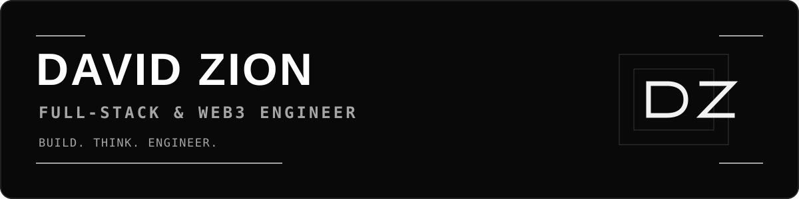

<div align="center">
  <picture>
    <source media="(prefers-color-scheme: dark)" srcset="./assets/david-zion-hero.svg">
    
  </picture>
</div>

<div align="center">
  <a href="https://git.io/typing-svg">
    
  </a>
</div>

<p align="center">
  Full-Stack Software Engineer with <strong>3 years of experience</strong> building modern applications,
  scalable systems and decentralized products in Nigeria.
</p>

<p align="center">
  <a href="https://github.com/0xdave1"></a>
  <a href="https://www.linkedin.com/in/davidjosepht"></a>
  <a href="https://x.com/heiszionn"></a>
  <a href="mailto:josephtaiwodavid@gmail.com"></a>
</p>

<br>


## 

<table>
  <tr>
    <td width="68%">
      I'm <strong>David Zion</strong>, a Full-Stack Software Engineer with three years of experience building modern applications, scalable systems and decentralized products.
      <br><br>
      I work across the software development lifecycle, from translating product requirements into technical solutions to designing application architecture, building interfaces, developing APIs, integrating databases and delivering functional products.
      <br><br>
      I'm passionate about engineering practical solutions, exploring blockchain technology and continuously improving the way software is designed and built.
    </td>
    <td width="32%" align="center">
      
    </td>
  </tr>
</table>

<br>

## 

### Programming Languages

<p align="center">
  
</p>

### Frontend Development

<p align="center">
  
</p>

### Blockchain &amp; Web3 Engineering

<p align="center">
  
  
  
  
  
  
  
  
  
</p>

### Backend Development

<p align="center">
  
</p>

### Databases &amp; Backend Services

<p align="center">
  
</p>

### DevOps &amp; Cloud Infrastructure

<p align="center">
  
</p>

### CI/CD &amp; Automation

<p align="center">
  
</p>

### API Development &amp; Testing

<p align="center">
  
</p>

### Monitoring &amp; Error Tracking

<p align="center">
  
</p>

### AI-Assisted Development

<p align="center">
  
  
</p>

<details>
  <summary><strong>Engineering stack at a glance</strong></summary>

  JavaScript · TypeScript · Solidity · Rust · React · Next.js · Tailwind CSS · Ethereum · Solana · Mantle · Foundry · Hardhat · Anchor · Web3.js · Ethers.js · Wagmi · Node.js · Express.js · PostgreSQL · MongoDB · Redis · Supabase · Firebase · Docker · Kubernetes · Terraform · AWS · Vercel · Nginx · Linux · Git · GitHub · GitHub Actions · Jenkins · Postman · Playwright · Sentry · Claude Code · Cursor
</details>

<br>

## 

<div align="center">
  <picture>
    <source media="(prefers-color-scheme: dark)" srcset="https://github-readme-streak-stats-eight.vercel.app?user=0xdave1&theme=dark&hide_border=true&background=090909&ring=A17B56&fire=8B674A&currStreakLabel=A17B56&sideLabels=F2F0EB&dates=A6A6A6">
    
  </picture>
</div>

<div align="center">
  <picture>
    <source media="(prefers-color-scheme: dark)" srcset="https://github-readme-stats.vercel.app/api?username=0xdave1&show_icons=true&theme=github_dark&hide_border=true&bg_color=090909&title_color=A17B56&icon_color=8B674A&text_color=F2F0EB">
    
  </picture>
  &nbsp;
  <picture>
    <source media="(prefers-color-scheme: dark)" srcset="https://github-readme-stats.vercel.app/api/top-langs/?username=0xdave1&layout=compact&theme=github_dark&hide_border=true&bg_color=090909&title_color=A17B56&text_color=F2F0EB">
    
  </picture>
</div>

<div align="center">
  
  &nbsp;
  
</div>

<div align="center">
  
</div>

<div align="center">
  
</div>

## 

<div align="center">
  <picture>
    <source media="(prefers-color-scheme: dark)" srcset="https://raw.githubusercontent.com/0xdave1/0xdave1/output/github-contribution-grid-snake-dark.svg">
    
  </picture>
</div>

<details>
  <summary><strong>Automated contribution artwork</strong></summary>
  The snake SVG is generated on a schedule and after pushes to the profile repository by the <code>Generate Contribution Snake</code> GitHub Actions workflow.
</details>

<br>

## 

<table>
  <tr>
    <td width="50%" valign="top">
      <h3>Lucky Sheep</h3>
      <p><strong>Web3 / Blockchain Gaming</strong></p>
      <p>A bilingual blockchain-gaming website preview centered on participation, countdown mechanics and protocol rewards. The repository explicitly identifies wallet actions and live protocol features as unavailable.</p>
      <p><sub>HTML · JavaScript · Static web</sub></p>
      <p><a href="https://luckysheep.vercel.app/">Live website</a> · <a href="https://github.com/0xdave1/luckysheep">Repository</a></p>
    </td>
    <td width="50%" valign="top">
      <h3>Lottery DApp</h3>
      <p><strong>Blockchain / Decentralized Application</strong></p>
      <p>A decentralized Ethereum lottery application built with React and Ethers.js, with Solidity contracts in the repository.</p>
      <p><sub>JavaScript · React · Solidity · Ethers.js</sub></p>
      <p><a href="https://github.com/0xdave1/lottery-dapp">Repository</a> · <a href="https://0xdave1.github.io/lottery-dapp">Live preview</a></p>
    </td>
  </tr>
  <tr>
    <td width="50%" valign="top">
      <h3>Vegan DAO</h3>
      <p><strong>Web3 / DAO</strong></p>
      <p>A DAO and cryptocurrency project built around Vegan Rob's Coin, with React, Ethers.js, Express and Solidity components.</p>
      <p><sub>JavaScript · React · Solidity · Ethers.js · Express</sub></p>
      <p><a href="https://github.com/0xdave1/Vegans-DAO">Repository</a></p>
    </td>
    <td width="50%" valign="top">
      <h3>Triggerly</h3>
      <p><strong>Software Development / AI Trigger Agent</strong></p>
      <p>A privacy-first trigger agent featuring an Expo React Native frontend and a NestJS, Prisma and PostgreSQL backend.</p>
      <p><sub>TypeScript · React Native · NestJS · Prisma · PostgreSQL</sub></p>
      <p><a href="https://triggerly-self.vercel.app/">Live website</a> · <a href="https://github.com/0xdave1/Triggerly">Repository</a></p>
    </td>
  </tr>
</table>

<br>

## 

```text
2026 ──  KIOOSK                                      Software Developer
         Frontend-first product engineering across interfaces, APIs and backend services
         Website: https://kioosk.online

2025 ──  COHOLD                                       Software Engineer
         Architecture, frontend, backend, APIs and database integration
         Website: https://cohold.co

NOW  ──  FREELANCE SOFTWARE DEVELOPMENT               Independent Engineer
         Client work and personal products across full-stack and Web3 systems
```

### CoHold
**Software Engineer · October 2025 – Present**

CoHold is a fractional real-estate investment platform that enables people to collectively invest in property.

- Contributes across frontend and backend development.
- Works on application architecture, interfaces, APIs and database integration.
- Implements authentication and core product functionality.
- Contributes to technical decisions and engineering direction.
- [cohold.co](https://cohold.co)

### Kioosk
**Software Developer · September 2026 – Present**

David primarily focuses on frontend engineering while contributing to backend development when required.

- Builds responsive user interfaces and application features.
- Integrates APIs and connects frontend components with backend services.
- Supports product functionality and maintainability.
- [kioosk.online](https://kioosk.online)

### Freelance Software Development
**Independent client projects and personal development**

Builds custom software applications, Web3 products and digital experiences across the full development lifecycle.

<br>

## 

<p align="center">
  
  
  
  
  
  
  
  
</p>

<br>

<h2 align="center">LET'S BUILD SOMETHING GREAT.</h2>

<p align="center">
  Open to meaningful engineering challenges, innovative products, technical collaborations and opportunities to build impactful software.
</p>

<p align="center">
  <a href="https://github.com/0xdave1"></a>
  <a href="https://www.linkedin.com/in/davidjosepht"></a>
  <a href="https://x.com/heiszionn"></a>
  <a href="mailto:josephtaiwodavid@gmail.com"></a>
</p>

<p align="center">
  
</p>

<p align="center">
  <em>Building with purpose. Engineering with precision.</em>
</p>
